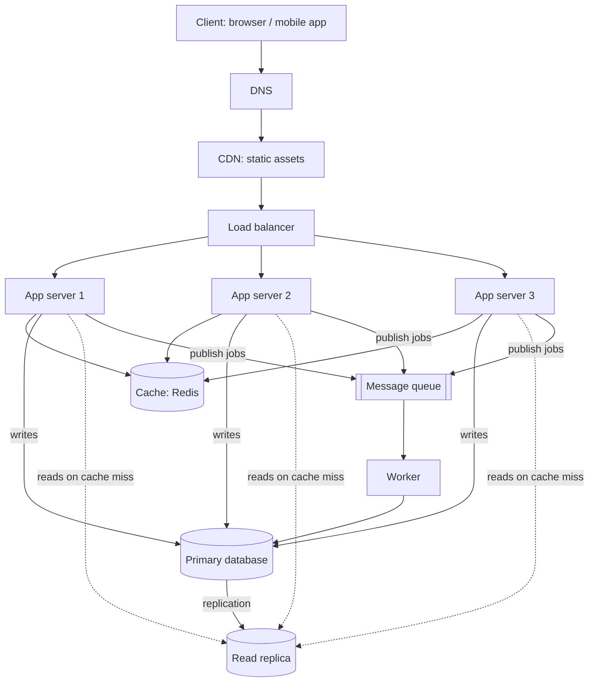

# QuickNotes Architecture

## 1. Requirements

### Functional
- Users sign up and log in.
- Users create, read, update and delete their own notes (title up to 100 characters, optional body).
- Users organise notes with tags and filter by tag.
- Users list notes with pagination.
- Background work after a write: search indexing and email/notification jobs.

### Non-functional
- **Scale:** 1 million registered users.
- **Availability:** 99.9% (about 8.7 hours of downtime per year at most); no single point of failure.
- **Latency:** p95 under 200 ms for API reads and under 500 ms for writes.
- **Durability:** an acknowledged note is never lost (replicated, backed up).
- **Security:** HTTPS everywhere, hashed passwords, each user can only access their own notes.
- **Consistency:** a user sees their own writes immediately; other views may lag by a few seconds (eventual consistency is acceptable).
- **Scalability:** servers can be added horizontally without code changes.

## 2. Load estimate (1 million users)

**Assumptions:** 30% of users are active daily (300,000 DAU); each active user reads 20 times and writes 5 times per day; peak traffic is 3 times the average; an average note is about 1 KB including row and index overhead; 1 day is about 86,400 seconds.

| Metric | Calculation | Result |
|--------|-------------|--------|
| Reads per day | 300,000 x 20 | 6,000,000 |
| **Reads per second** (average) | 6,000,000 / 86,400 | **about 70 /s** (peak about 210 /s) |
| Writes per day | 300,000 x 5 | 1,500,000 |
| **Writes per second** (average) | 1,500,000 / 86,400 | **about 17 /s** (peak about 52 /s) |
| New notes per year | 1,500,000 x 365 | about 548 million |
| **Storage per year** | 548 million x 1 KB | **about 550 GB** (about 1.1 TB with replica copies; add backups on top) |

Conclusion: the read:write ratio is about 4:1, and even peak traffic (about 260 requests per second) is modest. The design is built for availability and growth rather than raw throughput, so read replicas and a cache are enough before we ever need sharding.

## 3. Architecture diagram



Plain-text version of the same picture:

```
Client -> DNS -> CDN -> Load balancer -> App server 1 / 2 / 3
                                           |-> Cache (Redis)
                                           |-> Primary DB --replication--> Read replica
                                           |-> Queue -> Worker -> Primary DB
```

## 4. Components: the problem each one solves

- **Client:** gives the user an interface and calls the API over HTTPS, so no business logic or secrets live in the browser.
- **DNS:** turns the friendly name `api.quicknotes.com` into the load balancer's address, so we can move or replace servers without users noticing.
- **CDN:** serves static files (HTML, CSS, JS, images) from locations close to the user, which cuts latency and removes that traffic from our servers.
- **Load balancer:** spreads requests across app servers and removes unhealthy ones, so no single server is overloaded and one failure does not take the service down.
- **App servers (2 or more, stateless):** run the API logic; being stateless lets us add or remove servers freely to scale horizontally.
- **Cache (Redis):** keeps hot results in memory, so repeated reads skip the database and respond in under a millisecond.
- **Primary database:** the single source of truth for all writes, with transactions and constraints that keep data correct.
- **Read replica:** a live copy of the primary that handles read queries, which spreads read load and provides a standby for failover.
- **Queue:** holds background jobs (search indexing, notifications), so the user's request returns fast and jobs are not lost if a worker is down.
- **Worker:** takes jobs off the queue and runs the slow work asynchronously, so slow tasks never block API responses.

## 5. Request flows

### GET /v1/notes (read path)

1. The client sends `GET /v1/notes?limit=20` with its bearer token over HTTPS.
2. DNS resolves `api.quicknotes.com` to the load balancer (API calls are not cached by the CDN because they are per-user).
3. The load balancer picks a healthy app server (round robin).
4. The app server validates the token and extracts the user id.
5. It checks the cache for the key `notes:{userId}:{cursor}`.
6. **Cache hit:** return the cached JSON immediately (`200 OK`).
7. **Cache miss:** query the **read replica** (`WHERE user_id = ? ORDER BY created_at DESC LIMIT 20`), store the result in the cache with a 60-second TTL, and return `200 OK`.

### POST /v1/notes (write path)

1. The client sends `POST /v1/notes` with the JSON body and token.
2. DNS and the load balancer route it to a healthy app server.
3. The app server authenticates the user and validates the body (title required, max 100 characters). Invalid input returns `400`.
4. It inserts the note (and tag links) into the **primary database** in one transaction.
5. It deletes the user's cached list keys (`notes:{userId}:*`) so the next read is fresh.
6. It publishes a `note.created` message to the **queue**.
7. It returns `201 Created` with the new note and a `Location` header. The user does not wait for background work.
8. A **worker** consumes the message and performs the slow tasks (update the search index, send notifications). Failed jobs are retried and then moved to a dead-letter queue.

## 6. Trade-offs

1. **Cache and replica give speed, but data can be slightly stale.** Replication lag can be a few hundred milliseconds, and cache entries live up to 60 seconds. We accept eventual consistency for lists, and we avoid the "I can't see my note" problem by invalidating the cache on every write and by reading a just-written note from the primary.
2. **SQL gives integrity but scales writes vertically.** One primary caps write throughput. This is fine for about 52 writes per second at peak, and we can shard by `user_id` later if needed.
3. **Queue gives fast responses, but adds complexity.** Work done by workers is asynchronous, so jobs must be idempotent, monitored and retried; the benefit is that slow work never delays the user.
4. **More servers mean more cost and operations.** Running two or three app servers and a replica costs more than a single machine, but we pay for it with availability.

## 7. Avoiding single points of failure

| Component | How we avoid a single point of failure |
|-----------|----------------------------------------|
| DNS | Managed DNS with multiple name servers; short TTL for fast failover |
| CDN | Hundreds of edge locations; falls back to origin if an edge fails |
| Load balancer | Managed, multi-zone load balancer (or an active/passive pair); health checks remove bad servers |
| App servers | Three stateless servers spread over different availability zones; any one can fail |
| Cache | Redis with a replica and automatic failover; if the cache is lost the app still works by reading from the database (slower, not broken) |
| Database | Primary plus read replica; automatic promotion of the replica if the primary fails; daily backups and point-in-time recovery |
| Queue | Managed, replicated queue; messages stay stored until acknowledged |
| Worker | Two or more workers; if one dies, another picks up unacknowledged jobs |