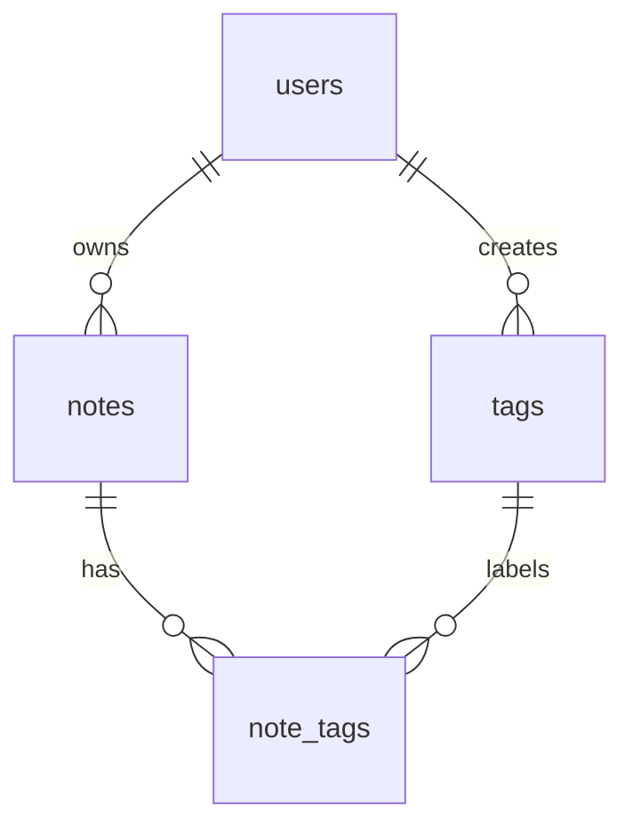

# QuickNotes Data Model

## 1. Entities

### users

| Column | Type | Key / constraint |
|--------|------|------------------|
| id | BIGINT (identity) | **Primary key** |
| email | VARCHAR(255) | Unique, not null |
| name | VARCHAR(100) | Not null |
| password_hash | VARCHAR(255) | Not null |
| created_at | TIMESTAMPTZ | Not null, default now() |

### notes

| Column | Type | Key / constraint |
|--------|------|------------------|
| id | BIGINT (identity) | **Primary key** |
| user_id | BIGINT | **Foreign key** to users(id), not null, ON DELETE CASCADE |
| title | VARCHAR(100) | Not null (matches the API's 100-character limit) |
| body | TEXT | Nullable (body is optional) |
| created_at | TIMESTAMPTZ | Not null, default now() |
| updated_at | TIMESTAMPTZ | Not null, default now() |

### tags

| Column | Type | Key / constraint |
|--------|------|------------------|
| id | BIGINT (identity) | **Primary key** |
| user_id | BIGINT | **Foreign key** to users(id), not null, ON DELETE CASCADE |
| name | VARCHAR(50) | Not null; unique together with user_id |

### note_tags (join table)

| Column | Type | Key / constraint |
|--------|------|------------------|
| note_id | BIGINT | **Primary key (part 1)** and **foreign key** to notes(id), ON DELETE CASCADE |
| tag_id | BIGINT | **Primary key (part 2)** and **foreign key** to tags(id), ON DELETE CASCADE |

## 2. Relationships

- **users to notes: one-to-many.** One user owns many notes; each note belongs to exactly one user (`notes.user_id`).
- **users to tags: one-to-many.** Each user has their own set of tags (`tags.user_id`).
- **notes to tags: many-to-many.** A note can have many tags, and a tag can be on many notes. A relational database cannot store this directly, so the join table `note_tags` holds one row per (note, tag) pair. Its composite primary key stops the same tag being attached to the same note twice.



## 3. CREATE TABLE statements (PostgreSQL)

```sql
CREATE TABLE users (
    id            BIGINT GENERATED ALWAYS AS IDENTITY PRIMARY KEY,
    email         VARCHAR(255) NOT NULL UNIQUE,
    name          VARCHAR(100) NOT NULL,
    password_hash VARCHAR(255) NOT NULL,
    created_at    TIMESTAMPTZ  NOT NULL DEFAULT now()
);

CREATE TABLE notes (
    id         BIGINT GENERATED ALWAYS AS IDENTITY PRIMARY KEY,
    user_id    BIGINT       NOT NULL REFERENCES users(id) ON DELETE CASCADE,
    title      VARCHAR(100) NOT NULL CHECK (length(trim(title)) > 0),
    body       TEXT,
    created_at TIMESTAMPTZ  NOT NULL DEFAULT now(),
    updated_at TIMESTAMPTZ  NOT NULL DEFAULT now()
);

CREATE TABLE tags (
    id      BIGINT GENERATED ALWAYS AS IDENTITY PRIMARY KEY,
    user_id BIGINT      NOT NULL REFERENCES users(id) ON DELETE CASCADE,
    name    VARCHAR(50) NOT NULL,
    UNIQUE (user_id, name)
);

CREATE TABLE note_tags (
    note_id BIGINT NOT NULL REFERENCES notes(id) ON DELETE CASCADE,
    tag_id  BIGINT NOT NULL REFERENCES tags(id)  ON DELETE CASCADE,
    PRIMARY KEY (note_id, tag_id)
);

-- Index (see section 5)
CREATE INDEX idx_notes_user_created ON notes (user_id, created_at DESC);
CREATE INDEX idx_note_tags_tag ON note_tags (tag_id);
```

## 4. Example queries

**1. List a user's 20 newest notes (backs `GET /v1/notes`):**

```sql
SELECT id, title, body, created_at
FROM notes
WHERE user_id = 17
ORDER BY created_at DESC
LIMIT 20;
```

**2. JOIN: list a user's notes together with their tags (used for `GET /v1/notes?tag=shopping`):**

```sql
SELECT n.id, n.title, t.name AS tag
FROM notes n
JOIN note_tags nt ON nt.note_id = n.id
JOIN tags t       ON t.id = nt.tag_id
WHERE n.user_id = 17
  AND t.name = 'shopping'
ORDER BY n.created_at DESC;
```

**3. Create a note (backs `POST /v1/notes`):**

```sql
INSERT INTO notes (user_id, title, body)
VALUES (17, 'Buy milk', '2 litres, semi-skimmed')
RETURNING id, created_at;
```

**4. Count notes per tag for a user (aggregation with GROUP BY):**

```sql
SELECT t.name, COUNT(nt.note_id) AS note_count
FROM tags t
LEFT JOIN note_tags nt ON nt.tag_id = t.id
WHERE t.user_id = 17
GROUP BY t.name
ORDER BY note_count DESC;
```

## 5. Indexes

- **`idx_notes_user_created ON notes (user_id, created_at DESC)`**: the most common query is "newest notes for one user". Without this index the database would scan the whole notes table (hundreds of millions of rows after a year). With it, the database jumps to the user's rows already sorted by date, so the query stays fast and supports cursor pagination.
- **`idx_note_tags_tag ON note_tags (tag_id)`**: the primary key already covers lookups by `note_id`; this second index makes "all notes with this tag" fast.
- `users.email` and `(tags.user_id, tags.name)` are indexed automatically by their UNIQUE constraints (login lookups are fast).

## 6. SQL or NoSQL?

I chose **SQL (PostgreSQL)**. QuickNotes data is clearly relational (users own notes, notes and tags are many-to-many), and we need integrity guarantees: foreign keys prevent orphan notes, unique constraints prevent duplicate tags and transactions make "create note and attach tags" all-or-nothing. The scale (about 17 writes per second on average, about 550 GB per year) is well within what a single PostgreSQL primary with a read replica handles, and the read-heavy workload is served by replicas and a cache. A NoSQL document store would suit schema-free data or write volumes beyond one primary, but we do not need that yet. If we grow past a single primary, we can shard notes by `user_id` because queries always filter by user.
